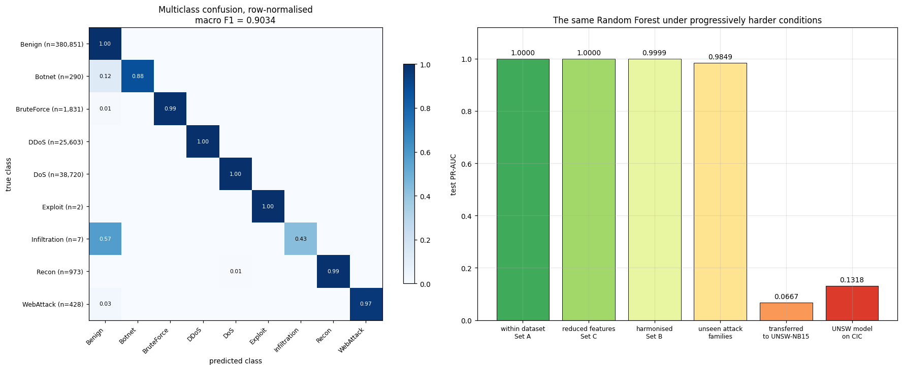
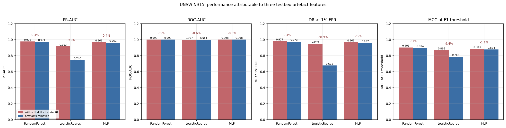
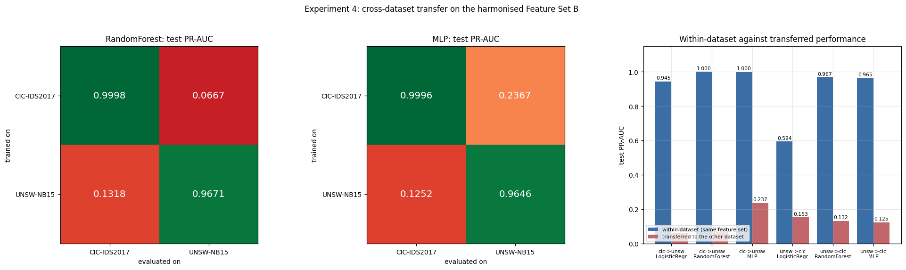

# NIDS Benchmark Reality Check: What Do 99.99% Detection Scores Actually Mean?

Machine-learning intrusion detectors routinely report near-perfect scores on public benchmarks, yet few of those numbers survive a change of network. This project builds one leak-free, reproducible pipeline over three benchmarks and then asks **how much of a "99.99%" result is real detection, and how much is the test setup.**



*The same model, features and metric (PR-AUC) change only in how hard the evaluation is.*

## Key results

| Evaluation condition | Random Forest PR-AUC |
|---|---|
| Standard split, CIC-IDS2017 | **0.99996** |
| Reduced to 40 of 75 features | 0.99995 (no loss) |
| Harmonised feature space across datasets | 0.99986 |
| Day-disjoint split (attack families unseen in training) | 0.98495 |
| Trained on one dataset, tested on another | **0.07 – 0.24** (6.7–23.7% of the in-dataset score) |

- At a 1% false-positive budget, a 40-feature Random Forest detects **99.994%** of attacks on CIC-IDS2017.
- Under cross-dataset transfer, one configuration scores a Matthews correlation of **−0.20**, worse than chance.
- On the day-disjoint split the headline score still looks fine (0.985) while **Botnet recall is 0.065** and PortScan recall is 0.345. An aggregate hides entire missed families.

## Research questions

| | Question | Answer |
|---|---|---|
| RQ1 | Which model and feature set is best under a fixed false-positive budget? | Random Forest on the reduced 40-feature set. The reduction is free, and a neural network is statistically different but operationally equivalent, and inference cost differs by roughly 50×. |
| RQ2 | Does performance carry over to another network? | No. A domain classifier separates the datasets at AUC 1.0 in the shared feature space (median source bytes differ 26×, byte rate 160×, attack prevalence 4×). |
| RQ3 | Does the imbalance strategy matter? | Very little for ranking quality. It mostly moves the decision threshold, which can be done for free. |

## Two findings worth highlighting

**1. Removing an artefact is not the same as removing dependence on it.** In UNSW-NB15 the traffic generator gave attacks a constant TTL value, so three TTL-derived columns separate the classes almost perfectly (AUC ≈ 0.99). Dropping them cost a logistic regression **19.0%** of its PR-AUC but a Random Forest only **0.4%**. The forest has not stopped using the artefact: it recovers the same signal from correlated columns. Deleting a suspicious column is therefore not enough for any model that can combine features.



**2. Resampling and thresholding are often confused.** On UNSW-NB15, class weighting raised recall at the default threshold from 0.904 to 0.997, but only by also raising false alarms from 0.4% to 1.4%. Simply moving the threshold lifted recall from 0.903 to 0.979 at no training cost. Undersampling was the only clearly harmful option, discarding 92% of the training data.



## Method in brief

| | |
|---|---|
| Data | CIC-IDS2017, UNSW-NB15 and NSL-KDD, about 4.4 million flow records in total |
| Pipeline | Leakage-controlled cleaning, harmonisation to a shared feature space, preprocessors fitted on training data only, saved state that can be verified |
| Feature sets | A: full (75 features), B: harmonised cross-dataset set, C: reduced (40 features) |
| Models | Logistic regression, Random Forest, MLP |
| Metrics | PR-AUC, detection rate at a 1% false-positive budget, MCC, with thresholds chosen on validation data and 3 seeds. Accuracy and ROC-AUC are de-emphasised because both flatter heavily imbalanced data. |
| Experiments | within-dataset, artefact ablation, unseen-family split, two-way transfer, five imbalance strategies |

## Limitations

- Binary flow-level detection only: no payload inspection, encrypted traffic, adversarial evasion or streaming deployment.
- Public benchmarks have known labelling and flow-construction flaws. CIC-IDS2017 in particular has been partly relabelled in other work.
- The notebooks were run on Colab. Notebook 03 (development experiments) contains one saved I/O error caused by a Drive write failure; notebook 04 re-uses its results as described there.
- Transfer results use one harmonised feature set, so a richer alignment method could narrow the gap.

## Repository map

```
notebooks/   01 data understanding → 02 preprocessing → 03 development runs → 04 final experiments (RQ1–RQ3)
results/     figures/ used in this README
```

The raw datasets are not included. Notebook 01 lists the public sources and Kaggle mirrors used, and each dataset has its own license. Notebooks keep their saved outputs.

## License

MIT for the code in this repository.
